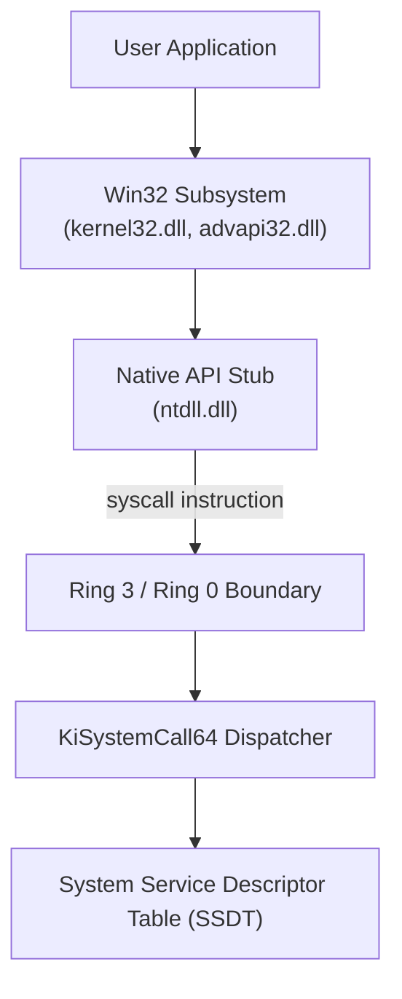
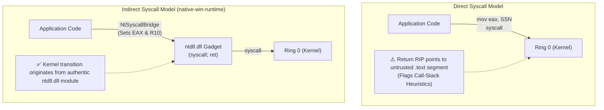
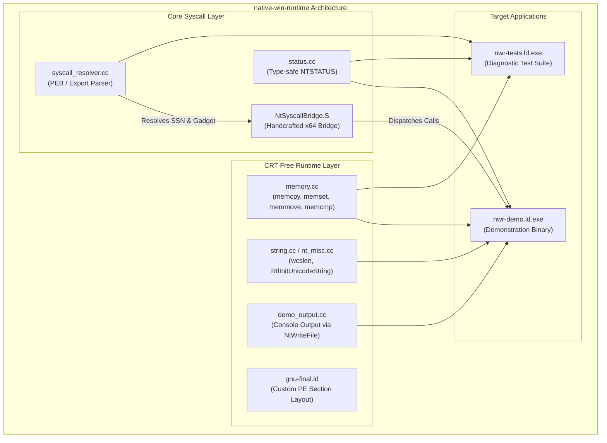
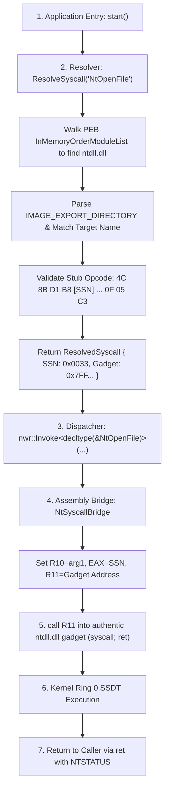

# native-win-runtime

**A Modular Windows x64 Native API Toolkit & CRT-Free Runtime Framework**

**`native-win-runtime`** is a high-performance Windows x64 systems engineering toolkit combining dynamic indirect NT system-call invocation with an independent, freestanding C-Runtime (CRT)-free execution model. It provides security engineers, reverse engineers, and systems programmers with direct access to the Windows kernel transition boundary without dependencies on standard C/C++ runtimes (`msvcrt.dll`, `ucrtbase.dll`) or Win32 subsystem APIs.

---

## Table of Contents

1. [Executive Summary](#executive-summary)
2. [Academic & Engineering Foundations](#academic--engineering-foundations)
   - [Windows Subsystem vs. Native API](#windows-subsystem-vs-native-api)
   - [Inline Userland Hooking vs. Kernel SSDT](#inline-userland-hooking-vs-kernel-ssdt)
   - [Direct vs. Indirect Syscall Dispatch](#direct-vs-indirect-syscall-dispatch)
   - [Call-Stack Legitimacy & ETW-TI Visibility](#call-stack-legitimacy--etw-ti-visibility)
3. [Relevance to Security & Reverse Engineering](#relevance-to-security--reverse-engineering)
4. [System Architecture](#system-architecture)
   - [Component Decomposition](#component-decomposition)
   - [End-to-End Execution Flow](#end-to-end-execution-flow)
   - [Assembly Bridge Mechanics](#assembly-bridge-mechanics)
5. [Repository Layout](#repository-layout)
6. [Step-by-Step Build & Execution Guide](#step-by-step-build--execution-guide)
   - [Prerequisites](#prerequisites)
   - [Step 1: Configure with CMake](#step-1-configure-with-cmake)
   - [Step 2: Build the Project](#step-2-build-the-project)
   - [Step 3: Run the Demonstration](#step-3-run-the-demonstration)
   - [Step 4: Run the Test Suite](#step-4-run-the-test-suite)
7. [API Reference](#api-reference)
8. [License](#license)

---

## Executive Summary

Standard Windows applications call high-level Win32 functions in `kernel32.dll` or `advapi32.dll`. These route to `ntdll.dll`, which loads a System Service Number (SSN) into `EAX` and triggers the `syscall` instruction to enter Ring 0.

Security monitoring tools (EDRs and AVs) routinely place inline detour hooks (`JMP` instructions) inside `ntdll.dll` to inspect parameters before kernel entry. 

**`native-win-runtime`** implements:
- **In-Memory Syscall Resolver**: Traverses the Process Environment Block (`PEB`) to locate `ntdll.dll` and parses its Export Directory without Win32 helpers (`GetModuleHandle`/`GetProcAddress`), dynamically discovering SSNs and authentic `syscall; ret` gadgets across Windows 10 and 11 builds.
- **Indirect Syscall Bridge**: Sets CPU registers (`EAX`, `R10`, `RDX`, `R8`, `R9`) locally, then calls into an authentic `syscall; ret` gadget inside `ntdll.dll` to preserve call-stack legitimacy and bypass userland inline hooks.
- **CRT-Free Execution**: Boots directly at `.text$start` (`start()`), implementing intrinsic-safe memory operations (`memcpy`, `memset`, `memmove`, `memcmp`) and outputting to the console via `NtWriteFile` on the PEB standard output handle.

---

## Academic & Engineering Foundations

### Windows Subsystem vs. Native API



While Win32 exports remain stable across Windows versions, Native API System Service Numbers (SSNs) are undocumented and change between Windows builds, service packs, and cumulative updates.

### Inline Userland Hooking vs. Kernel SSDT

When an EDR sensor instruments a process, it overwrites the prologue of `ntdll.dll` stubs:

```assembly
; Original ntdll export stub
ntdll!NtOpenFile:
    4C 8B D1             mov r10, rcx
    B8 33 00 00 00       mov eax, 0033h
    0F 05                syscall
    C3                   ret

; Hooked ntdll stub
ntdll!NtOpenFile:
    E9 7B 12 34 12       jmp edr_sensor!Hooked_NtOpenFile   ; Diverted to userland hook
    90                   nop
    90                   nop
```

Because user-mode hooks exist in the same memory space as the process itself, an application can read the clean export directory, extract the SSN, and dispatch the system call directly.

### Direct vs. Indirect Syscall Dispatch



- **Direct Syscalls**: Executing `syscall` inside the application's own `.text` section bypasses userland hooks, but causes the return address recorded at kernel transition to point to untrusted memory, triggering call-stack inspection detections.
- **Indirect Syscalls**: Setting registers locally and jumping to an authentic `syscall; ret` gadget inside `ntdll.dll` ensures that the transition originates from valid module memory.

### Call-Stack Legitimacy & ETW-TI Visibility

Indirect system calls do not blind the operating system:
- **Userland Hooks**: Bypassed because execution enters `ntdll.dll` after the hooked prologue.
- **Kernel SSDT Dispatch**: Unaffected (`KiSystemCall64` processes the SSN normally).
- **ETW-TI (Threat Intelligence)**: Unaffected (emitted directly from kernel space).
- **Kernel Callbacks**: Unaffected (`ObRegisterCallbacks`, process/thread creation callbacks, and minifilter drivers operate at the kernel layer).

---

## Relevance to Security & Reverse Engineering

### For Security Engineers
- **Sensor Efficacy Audits**: Evaluates whether detection systems trigger when userland inline hooks are bypassed.
- **Stack-Frame Inspection**: Benchmarks synthetic stack frame detection and RIP legitimacy algorithms.
- **Kernel Telemetry Verification**: Confirms that kernel-level sensors (ETW-TI, driver callbacks) capture activity independently of userland hooks.

### For Reverse Engineers
- **Evasion Pattern Identification**: Recognizes raw syscall bridges, custom PEB stub parsers, and dynamic SSN resolution routines in compiled binaries.
- **Importless Analysis**: Demonstrates how malware loaders navigate the PEB and parse export tables without invoking `GetModuleHandle` or `GetProcAddress`.
- **CRT-Free Disassembly**: Provides clear insights into compact assembly structures, register lifetimes, and linker alignment without compiler runtime templates.

---

## System Architecture

### Component Decomposition



### End-to-End Execution Flow



### Assembly Bridge Mechanics

The assembly bridge (`src/nt_syscall_bridge.S`) handles register translation across calling conventions:

```assembly
.intel_syntax noprefix
.text

.global NtSyscallBridge
NtSyscallBridge:
        mov     r11, rdx            # r11 = syscallRetGadget (address in ntdll)
        mov     eax, ecx            # eax = syscallNumber (SSN)

        mov     r10, r8             # arg1 -> r10 (kernel argument register)
        mov     rcx, r8             # arg1 -> rcx
        mov     rdx, r9             # arg2 -> rdx
        mov     r8,  [rsp+0x28]     # arg3 -> r8
        mov     r9,  [rsp+0x30]     # arg4 -> r9

        add     rsp, 0x18           # Align stack frame
        call    r11                 # Jump indirectly to syscall; ret in ntdll
        sub     rsp, 0x18           # Restore stack frame

        ret                         # Return NTSTATUS in RAX
```

---

## Repository Layout

```
native-win-runtime/
├── include/
│   ├── native_win_runtime.hh        Unified master header
│   └── native_win_runtime/
│       ├── status.hh                Type-safe NTSTATUS wrapper
│       └── syscall_resolver.hh      Dynamic syscall resolver declarations
├── src/
│   ├── nt_syscall_bridge.S          x64 assembly indirect syscall bridge
│   ├── status.cc                    NTSTATUS string decoding & severity tables
│   └── syscall_resolver.cc          In-memory PE parser & stub validator
├── runtime/
│   ├── include/
│   │   ├── stdio.h                  Freestanding C stdio redirect
│   │   └── cstdio                   Freestanding C++ stdio redirect
│   ├── src/
│   │   ├── memory.cc                CRT-free memcpy, memset, memmove, memcmp
│   │   ├── string.cc                CRT-free wcslen
│   │   ├── nt_misc.cc               RtlInitUnicodeString implementation
│   │   └── fltused.cc               MSVC linker floating-point symbol
│   └── CMakeLists.txt               Runtime object library (nwr-runtime)
├── demo/
│   ├── main.cc                      Demonstration application
│   ├── demo_output.cc               Console output via direct NtWriteFile
│   └── CMakeLists.txt               Demo target configuration (nwr-demo)
├── tests/
│   ├── test_status.cc               Status classification tests
│   ├── test_runtime_helpers.cc      Memory/string primitive unit tests
│   ├── test_resolver.cc             In-memory resolution verification
│   └── CMakeLists.txt               Test harness configuration (nwr-tests)
├── third_party/
│   ├── phnt/                        Process Hacker native headers (submodule)
│   └── printf/                      Freestanding printf library (submodule)
├── cmake/
│   ├── minimal-build-settings.cmake LLVM / Clang build configuration
│   ├── override-link-rules.cmake    LTO optimization directives
│   ├── gnu-link.cmake               MinGW GNU linker integration
│   └── gnu-final.ld                 Custom PE section packing linker script
├── CMakeLists.txt                   Root CMake orchestration
├── CMakePresets.json                Configuration presets
├── LICENSE                          MIT License
└── README.md                        Project documentation
```

---

## Step-by-Step Build & Execution Guide

### Prerequisites

- **Clang / LLVM** (Clang 20+ recommended)
- **CMake** (v3.20+) and **Ninja**
- **MinGW-w64** (`ld` / `x86_64-w64-mingw32-ld`)
- **Windows SDK** (for headers)

### Step 1: Configure with CMake

Configure the build directory using the default preset:

```cmd
cmake --preset default
```

Output:
```text
-- The CXX compiler identification is Clang 20.1.8 with GNU-like command-line
-- The ASM compiler identification is Clang with GNU-like command-line
-- Found assembler: C:/Program Files/LLVM/bin/clang.exe
-- The C compiler identification is Clang 20.1.8 with GNU-like command-line
-- Configuring done
-- Generating done
-- Build files have been written to: C:/Users/USERNAME/Desktop/native-win-runtime/build
```

### Step 2: Build the Project

Build all libraries, the demonstration binary, and the test suite:

```cmd
cmake --build --preset default -v
```

This compiles both direct LLD-linked binaries (`nwr-demo.exe`, `nwr-tests.exe`) and GNU-ld finalized binaries (`nwr-demo.ld.exe`, `nwr-tests.ld.exe`).

### Step 3: Run the Demonstration

#### A. Default Execution (Reads `notepad.exe`)

```cmd
.\build\demo\nwr-demo.ld.exe
```

Output:
```text
  native-win-runtime demonstration
  Windows x64 direct NT syscall dispatch
  Version 1.0.0

  Built without the C runtime (CRT-free)
  Syscall numbers resolved at runtime from ntdll.dll

  ----------------------------------------
  [OK]   Located ntdll.dll at 0x00007ffb6ac40000
  [OK]   Resolved NtOpenFile, syscall number: 0x0033
  [OK]   Resolved NtReadFile, syscall number: 0x0006
  [OK]   Resolved NtClose, syscall number: 0x000F
  ----------------------------------------
  [OK]   Opened file (handle: 0x00000000000000a4)
  [OK]   Read 64 bytes
  [OK]   Closed file handle
  ----------------------------------------

  Hex dump (64 bytes):
  4D 5A 90 00 03 00 00 00 04 00 00 00 FF FF 00 00 
  B8 00 00 00 00 00 00 00 40 00 00 00 00 00 00 00 
  00 00 00 00 00 00 00 00 00 00 00 00 00 00 00 00 
  00 00 00 00 00 00 00 00 00 00 00 00 F8 00 00 00 

  All operations completed successfully.
```

*(Bytes `4D 5A` correspond to the DOS `MZ` executable header, validating byte-level read operations via unhooked indirect syscalls).*

#### B. Display Help (`--help`)

```cmd
.\build\demo\nwr-demo.ld.exe --help
```

Output:


```text
Usage: nwr-demo [OPTIONS]

Options:
  --file <path>    NT path to read (default: notepad.exe)
  --bytes <count>  Number of bytes to read (default: 64, max: 4096)
  --help           Show this help message
  --version        Show version information

Examples:
  nwr-demo
  nwr-demo --file "\??\C:\Windows\System32\cmd.exe" --bytes 128
```

#### C. Display Version (`--version`)

```cmd
.\build\demo\nwr-demo.ld.exe --version
```

Output:
```text
native-win-runtime demo v1.0.0
```

#### D. Custom File Read (Reading 128 bytes from `cmd.exe`)

```cmd
.\build\demo\nwr-demo.ld.exe --file "\??\C:\Windows\System32\cmd.exe" --bytes 128
```

Output:
```text
  native-win-runtime demonstration
  Windows x64 direct NT syscall dispatch
  Version 1.0.0

  Built without the C runtime (CRT-free)
  Syscall numbers resolved at runtime from ntdll.dll

  ----------------------------------------
  [OK]   Located ntdll.dll at 0x00007ffb6ac40000
  [OK]   Resolved NtOpenFile, syscall number: 0x0033
  [OK]   Resolved NtReadFile, syscall number: 0x0006
  [OK]   Resolved NtClose, syscall number: 0x000F
  ----------------------------------------
  [OK]   Opened file (handle: 0x00000000000000a4)
  [OK]   Read 128 bytes
  [OK]   Closed file handle
  ----------------------------------------

  Hex dump (128 bytes):
  4D 5A 90 00 03 00 00 00 04 00 00 00 FF FF 00 00 
  B8 00 00 00 00 00 00 00 40 00 00 00 00 00 00 00 
  00 00 00 00 00 00 00 00 00 00 00 00 00 00 00 00 
  00 00 00 00 00 00 00 00 00 00 00 00 F8 00 00 00 
  0E 1F BA 0E 00 B4 09 CD 21 B8 01 4C CD 21 54 68 
  69 73 20 70 72 6F 67 72 61 6D 20 63 61 6E 6E 6F 
  74 20 62 65 20 72 75 6E 20 69 6E 20 44 4F 53 20 
  6D 6F 64 65 2E 0D 0D 0A 24 00 00 00 00 00 00 00 

  All operations completed successfully.
```

### Step 4: Run the Test Suite

```cmd
.\build\tests\nwr-tests.ld.exe
```

Output:
```text
  native-win-runtime test suite

--- Status tests ---
  [PASS] STATUS_SUCCESS is success
  [PASS] STATUS_SUCCESS is not error
  [PASS] STATUS_SUCCESS converts to true
  [PASS] STATUS_SUCCESS severity == 0
  [PASS] STATUS_IMAGE_NOT_AT_BASE is info
  [PASS] Info status is still success
  [PASS] Info status is not error
  [PASS] STATUS_BUFFER_OVERFLOW is warning
  [PASS] Warning is not success
  [PASS] Warning is not error
  [PASS] STATUS_ACCESS_VIOLATION is error
  [PASS] Error is not success
  [PASS] Error severity == 3
  [PASS] Equality: same values are equal
  [PASS] Inequality: different values are not equal
  [PASS] STATUS_SUCCESS code == 0
  [PASS] STATUS_ACCESS_VIOLATION code == 5
  [PASS] STATUS_SUCCESS to_string starts with S
  [PASS] STATUS_ACCESS_VIOLATION to_string starts with S

--- Runtime helper tests ---
  [PASS] memset fills buffer correctly
  [PASS] memcpy copies correctly
  [PASS] memcmp: equal buffers return 0
  [PASS] memcmp: lesser buffer returns negative
  [PASS] memcmp: greater buffer returns positive
  [PASS] memcmp: partial equal returns 0
  [PASS] memmove: non-overlapping copy
  [PASS] memmove: overlapping forward
  [PASS] memmove: overlapping backward
  [PASS] wcslen: empty string
  [PASS] wcslen: "hello" == 5
  [PASS] wcslen: single char == 1
  [PASS] RtlInitUnicodeString: Length correct
  [PASS] RtlInitUnicodeString: MaximumLength correct
  [PASS] RtlInitUnicodeString: Buffer not null
  [PASS] RtlInitUnicodeString: null source Length == 0
  [PASS] RtlInitUnicodeString: null source Buffer == nullptr

--- Resolver tests ---
  [PASS] GetNtdllBase returns nonzero
  [PASS] ResolveSyscall(NtClose) succeeds
  [PASS] NtClose: resolved syscall is valid
  [PASS] NtClose: syscall_ret is nonzero
  [PASS] ResolveSyscall(NtOpenFile) succeeds
  [PASS] ResolveSyscall(NtReadFile) succeeds
  [PASS] ResolveSyscall(NtWriteFile) succeeds
  [PASS] ResolveSyscall(nonexistent) fails
  [PASS] Nonexistent reports FunctionNotFound
  [PASS] ResolveSyscall(wchar_t NtClose) succeeds
  [PASS] NtClose number is consistent
  [PASS] ResolveSyscall(ZwClose) succeeds
  [PASS] ZwClose and NtClose have same number
  [PASS] NtClose(nullptr) returns error status

  Tests complete.
```

---

## API Reference

### Dynamic Syscall Resolution and Dispatch

```cpp
#include <native_win_runtime.hh>
#include <phnt_windows.h>
#include <phnt.h>

void Example()
{
    // 1. Dynamically resolve SSN and gadget address
    nwr::ResolveResult res = nwr::ResolveSyscall("NtClose");
    if (!res)
    {
        const char* err = nwr::resolve_error_string(res.error);
        return;
    }

    // 2. Dispatch call indirectly via assembly bridge
    HANDLE handle = nullptr;
    NTSTATUS rawStatus = nwr::Invoke<decltype(&NtClose)>(res.syscall, handle);

    // 3. Inspect status code
    nwr::Status status(rawStatus);
    if (status.is_error())
    {
        uint16_t code = status.code();
        const char* name = status.to_string();
    }
}
```

---

## License

This project is licensed under the [MIT License](LICENSE).
Third-party submodules (`phnt`, `printf`) are licensed under their respective upstream terms.
